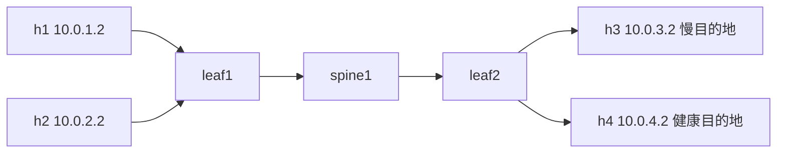

# 03-fault-inject · 四大故障的注入剧本与遥测指纹

> **教学级实验，非硬件行为等价。** PFC 是链路层的暂停帧，只有交换机或支持 DCB 的
> 网卡才发得出来。容器里造不出真 pause 帧，只能造出「等效观测形态」：
> 用大缓冲加限速，让丢包变成堆积，剩下的由模型补上真机会看到的计数器读数。
> 边界划分写在 [第 2 节](#2-能真跑的部分与只能建模的部分)。

## 1. 这个 lab 做什么

第 07 课讲了四类故障：PFC 风暴、PFC 死锁、incast、队头阻塞。
每类的成因不同，但告警长得像。区别全在遥测形态里：

| 故障 | 丢包 | 周期 | 空间形态 | 时延 |
|---|---|---|---|---|
| PFC 风暴 | 0 | 否 | 成片，沿拓扑向上游蔓延 | 5 倍以上，持续 |
| PFC 死锁 | 0 | 否 | 由环决定，与流量无关 | 直接超时 |
| incast | 非 0 | 是，与训练步同步 | 指向少数汇聚点 | 周期性尖刺 |
| 队头阻塞 | 近似 0 | 否 | 集中在共享段 | 温和抬升 1.5–2.5 倍 |

这个 lab 把这张表做成四件东西：

1. **注入剧本** —— 四个场景各自的命令序列，可以在容器拓扑里真跑，也给了真机做法
2. **遥测指纹模型** —— 每类故障的计数器时序样本，落成 CSV，供你练习判读
3. **判读器** —— 一份把上述判据写成代码的分类器。它的判据就是这张表
4. **真实 PFC Pause 帧注入与抓包验证** —— 见下节与 `scripts/inject_pfc_pause.py`，突破传统虚拟网络无 `0x8808` 帧的局限

对应课程：[07 无损网络四大典型故障](../../site/docs/02-lossless/07-fault-modes.md)。

## 2. 能真跑的部分，与只能建模的部分

诚实是第一位的。这个 lab 分三块：

| 块 | 依赖 | 做什么 | 不能做什么 |
|---|---|---|---|
| **剧本与判读**（默认） | 仅 Go | 生成注入命令、生成指纹样本、给出判读 | 不碰网络 |
| **容器注入与抓包**（`make deploy` + `make inject-pfc`） | Docker + containerlab | 真限速、真排队、真丢包、真时延、**可抓到真实 `0x8808` Pause 帧** | 硬件级芯片反压停发（需真实交换机/DCB 网卡） |
| **真机验证**（README 第 7 节） | 交换机 DCB | 真 PFC、真 ECN、真 per-priority 计数 | 需要真实设备 |

在默认容器网络下，纯 veth 虚拟口无法通过常规协议栈生成硬件流控帧。本项目提供了专用底层工具：
- `scripts/inject_pfc_pause.py`：通过底层原始套接字直接构造并注入符合 IEEE 802.3x / 802.1Qbb 规范的真实 PFC Pause 帧（`0x8808`，OpCode `0x0101`，优先级 3 掩码与 Quanta）。
- 执行 `make deploy && make inject-pfc` 后，读者可以在对端容器中用真实 `tcpdump -i eth1 ether proto 0x8808 -xx -vv` 抓取并验证真实的优先流控暂停帧，打通虚拟实验与真实报文协议栈的隔阂。

样本 CSV 里的 `pause_pct` 列仍由模型结合上述时序给出。真机采集时这一列
来自交换机的 `priority-flow-control counters`。两边的列名一致，判读器不区分来源。

> **注意：** README 里凡是「模型给的」都标了。把模型输出当真机读数引用，
> 是这类 lab 最常见的误用。

## 3. 跑起来

```bash
cd labs/03-fault-inject
make run        # 四个场景：计划 + 样本摘要 + 判读结论，全程零依赖
make plan       # 只看注入剧本
make sim        # 生成 samples/model-*.csv
make classify   # 判读 samples/ 下的样本
make test       # 12 个单测：判读逻辑 + 拓扑一致性 + PFC 帧字节布局

# 以下需要 Docker + containerlab（推荐 Codespaces）
make deploy      # 起 6 节点拓扑
make inject-pfc  # 向 veth 注入真实 0x8808 PFC pause 帧
make inject S=storm   # 按场景执行 tc 注入
make destroy     # 清 qdisc 并拆除拓扑
```

抓到真实 pause 帧的办法：

```bash
docker exec clab-fault-inject-h3 sh -lc 'tcpdump -i eth1 ether proto 0x8808 -c 3 -xx'
```

输出里 `0180 c200 0001` 是标准流控组播目的地址，`8808` 是 EtherType，
其后 `0101` 是 PFC OpCode。整个帧 64 字节（含填充，不含 FCS）。

`make run` 的输出结构，每个场景三段：

```text
== storm · 注入计划 ==            剧本：在哪台节点、为什么、敲什么
== storm · 样本摘要 ==            形态：每个端口的基线、峰值、超时数
== 判读结论：PFC 风暴 ==          结论：依据 + 下一步
```

## 4. 四个场景

### storm · PFC 风暴

反压从一台消费不动的端口出发，沿拓扑向上游蔓延。
指纹是**零丢包 + 多端口同期劣化 + 时延台阶式抬升**。

容器版做法：把 leaf2 的上行做成 400ms 大缓冲 + 40mbit 限速，
两条 30mbit 的流打进去。丢包被换成堆积，效果与 PFC 同向。

### deadlock · PFC 死锁

两个方向互相等待，缓冲永远满载。
指纹是**超时 + 零丢包**这一对矛盾组合：报文没被扔，只是永远出不去。

容器版做法：双向限到 2mbit，超大缓冲，两个方向的流同时打。

### incast · 多打一

两个发送端同时打一个接收端，汇聚口周期性溢出。
指纹是**丢包非零 + 周期性 + 指向单一汇聚点**，周期等于训练步的周期。

容器版做法：leaf2 到 h3 的口限 25mbit，两个 20mbit 发送端同时打。

### hol · 队头阻塞

一条大象流占满共享队列，旁边的小流被拖慢，而它自己的目的地完全健康。
指纹是**时延温和抬升 + pause 与 ECN 都低**：机制没坏，只是排队。

容器版做法：leaf2 上行限 40mbit，38mbit 大象流 + 1mbit 无辜流走同一队列。

## 5. 真实 pause 帧与 XDP 反压闸门

上面四个场景的容器做法都是「用限速与缓冲等效模拟反压」。这一节补上两样真实的东西。

### 5.1 真帧：`0x8808` 抓得到

`scripts/inject_pfc_pause.py` 用 `AF_PACKET` 原始套接字自己拼帧发出去，
字段全部按标准来：

| 字段 | 值 | 说明 |
|---|---|---|
| 目的 MAC | `01:80:c2:00:00:01` | IEEE 802.3x 流控组播地址 |
| EtherType | `0x8808` | 链路层控制帧 |
| OpCode | `0x0101` | PFC（802.1Qbb） |
| class-enable | 位图，如 `0x0008` | 第 N 位对应优先级 N |
| Quanta | 8 个 16 位值 | 每个优先级的暂停配额，512 bit-time 为单位 |

帧填充到 60 字节（不含 FCS），驱动发出去后线上是 64 字节。

```bash
make deploy
# 一个终端先抓包
docker exec clab-fault-inject-h3 tcpdump -i eth1 ether proto 0x8808 -c 3 -xx
# 另一个终端注入
make inject-pfc NODE=leaf2 IF=eth1 PRIO=3 COUNT=10
```

注入脚本先在容器里找 `python3`；找不到就走第二条路，用宿主机 python3 配合
`nsenter --net=/var/run/netns/clab-fault-inject-leaf2` 切进容器网络命名空间发帧。
两条路径发的帧完全一样。

抓包输出里能看到 `0180 c200 0001 0200 0000 0001 8808 0101 0008 ...`，
这就是交换机真正在处理的那种帧。**协议层不再是模型，是真的。**

### 5.2 闸门：XDP 在驱动层拦报文

`scripts/xdp_pfc.c` 是不到 80 行的最小 XDP 程序，挂载在容器的 veth 入方向。
它管三个 pinned map：

| map | 作用 |
|---|---|
| `pfc_gate` | 1 表示拦掉后续数据帧（模拟 XOFF 之后对端停发），0 放行 |
| `pfc_dropped` | 被拦掉的帧数 |
| `pfc_pause_seen` | 收到的 `0x8808` 帧数，与注入端对账 |

```bash
make xdp-build                          # clang -target bpf 编出 xdp_pfc.o
make xdp-attach NODE=leaf2 IF=eth1      # 挂到该节点 veth 入方向
make xdp-close                          # 水线触顶：拦截后续数据帧
make inject-pfc                         # 同时注入真实 pause 帧
make xdp-stats                          # 看 dropped 与 pause_seen 两个计数
make xdp-open                           # 水线回落：恢复放行
make xdp-off NODE=leaf2 IF=eth1         # 卸载
```

veth 在节点的网络命名空间里，宿主机看不到，所以挂载与卸载经
`nsenter --net=/var/run/netns/clab-fault-inject-<node>` 执行。三个 map 用
`LIBBPF_PIN_BY_NAME` 自动 pin 到 `/sys/fs/bpf/pfc_*`，之后 `bpftool` 直接读写。

一句话说清边界：**`XDP_DROP` 是丢弃，不是暂停。** 真停发要 DCB 网卡与交换机协商
per-priority 流控。这里做到的是「线上有真帧、内核有真拦截」，硬件行为仍然不模拟。

## 6. 拓扑

```text
h1 ─┐                   ┌─ h3  慢目的地
    ├─ leaf1 ─ spine1 ─ leaf2
h2 ─┘                   └─ h4  健康目的地
```

同一张图用 Mermaid 再画一次，GitHub 与 IDE 里能直接渲染：



六个节点，地址用 /30 一段一段给。交换机不做二层桥，直接三层转发。
理由很实在：**二层桥会把队列藏起来**，三层转发能让每一跳的出队列都暴露在 `tc` 里。

接口与地址的对照表写在 [topo.clab.yml](topo.clab.yml) 开头，改动时先看那张表。

## 7. 真机怎么验证

容器里缺的那一层，真机补上：

```bash
# 1. 交换机上开 PFC 与 ECN，优先级映射两端一致
# 2. 注入同样的流量形态
# 3. 采这些计数器，每分钟一次，落成 CSV
show priority-flow-control interface <intf> counters   # per-priority pause 帧数与时长
show queue-monitor interface <intf>                    # 队列水线、丢弃
show interface <intf> | include (CRC|FEC)              # 端口错误与纠错
```

采集结果的列名与 `samples/model-storm.csv` 一致，就能直接喂给判读器：

```bash
go run . -classify -dir <你的样本目录>
```

判读器不区分「模型给的样本」和「你真采的样本」。这是有意的：
先把判据跑通，再上真机，比在真机上边调边猜省时间。

## 8. 判读器怎么写的

打开 [classify.go](classify.go)，核心是判定顺序。顺序本身是知识：

```text
① 超时占比高 + 不丢包  → 死锁      报文卡住而不是被扔
② 有丢包 + 周期性      → incast    同步突发打满汇聚口
③ 有丢包 + 无周期      → 持续性丢包  PFC 没生效或水线过高
④ pause 高 + 时延 2.5 倍以上 → 风暴  反压成片蔓延
⑤ pause 低 + 时延温和  → 队头阻塞  机制正常，只是在排队
```

先判丢包，再判周期，再判 pause，最后才看时延。原因：
**丢包是机制层面的分水岭**，无损网络里出现丢包说明反压没接住，先解决这个。
时延放在最后，因为它受路径、采样、探测实现影响，噪声最大。

阈值集中在 `DefaultThresholds()`，想改口径改那一处：

| 阈值 | 默认 | 依据 |
|---|---|---|
| `LossPct` | 0.05% | 无损网络里持续丢包本身就是异常 |
| `PauseSevere` | 5% | 10 分钟窗口里 pause 超过 10 秒即为严重（约 1.7%），留三倍余量 |
| `LatRatio` | 1.2 倍 | 探测本身有抖动，1.2 倍以内算噪声 |
| `PeriodCV` | 0.5 | 尖刺间隔的变异系数，小于它才算周期性 |

## 9. 样本从哪来

`samples/model-*.csv` 由 `make sim` 生成，是确定性产物：固定种子，跑两遍逐字节一致。
CI 用 `make expected` 重跑一遍，比对 `samples/` 与 `expected/`，不一致就红。

模型怎么建的在 [model.go](model.go)：每个端口一组「基线 + 劣化增量」，
四类故障靠组合这些增量表达。窗口、粒度、劣化起点都在 [scenario.go](scenario.go) 里。

抖动幅度是乘性的，`-seed` 可改。判读结论不该随种子翻转 ——
这正是 `TestVerdictStableAcrossSeeds` 守的东西：**判据贴着阈值走，说明它不值得信。**

## 10. 思考题

1. 把 `DefaultThresholds().PauseSevere` 从 5 改到 30，重跑 `make run`。
   哪个场景的结论先变？变了之后最可能被误判成什么？这解释了为什么口径要写死在文档里。
2. 给 incast 场景加一个 `-seed 7`，尖刺间隔还是 4 秒吗？
   把 `Period` 改成 5，判读器还能判成 incast 吗？周期抖动到多少会判不出来？
3. 死锁场景里，healthy 端口全程正常。如果真实故障里「健康端口」也开始变慢，
   说明什么？该往哪一层查？
4. 用 `-sim` 生成样本后，把 `pause_pct` 列全改成 0，再跑 `make classify`。
   哪些结论变了、哪些没变？这告诉你 pause 计数在判读里到底承担多少权重。
5. 跑一次 `make xdp-close` 再 `make xdp-stats`，`pfc_dropped` 在涨而 `pfc_pause_seen` 不动。
   这两个计数各自证明了什么？如果换成真交换机，哪个计数会由硬件维护、哪个查不到？

## 11. 模型边界

这个 lab 是**判读训练器**，不是网络仿真器。明确不做的事：

- 不模拟 pause 帧的逐跳传播延迟。真机里这个延迟是风暴的关键参数
- 不模拟 per-priority 队列。样本里一个端口只有一个 pause 读数
- 不模拟 ECN 的三段水线与 DCQCN 的降速闭环。要看那个去 [02-pfc-sim](../02-pfc-sim/README.md)
- 不模拟哈希与多路径。要看那个去 [05-clos-topo](../05-clos-topo/README.md)

帧能造，反压停发造不了：`scripts/inject_pfc_pause.py` 注入的是**格式完全正确**、
能被 `tcpdump` 与交换机解出来的 `0x8808` 帧；但它只是向线上发帧，不会真的让
对端网卡停下来。真正的停发需要 DCB 硬件与协商好的 per-priority 流控。
这两件事的区别，就是「协议报文可验证」与「硬件行为可复现」的区别。

一句话：**这里练的是「看到什么读数判成什么故障」，不是「故障怎么发生」。**
